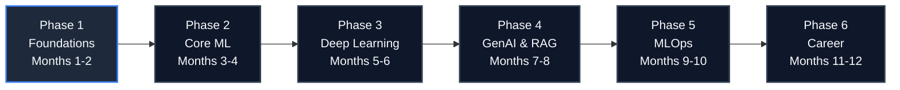

<div align="center">

<h1>AI/ML Handwritten Notes</h1>
<h3>A 12-Month Journey from Python Fundamentals to Production-Grade AI Engineering</h3>

<p>
  <b>By <a href="https://github.com/aniket-andyy">Aniket Sharma (Andyy)</a></b>
</p>

<p>
  A comprehensive, handwritten knowledge repository documenting a rigorous 12-month curriculum in Artificial Intelligence and Machine Learning. From core Python and mathematics to advanced GenAI, RAG architectures, and production MLOps.
</p>

<br>

<p>
  
  
  
  
  
  
  
  
</p>

<p>
  
  
  
  
  
</p>

</div>

---

## 📑 Table of Contents

- [About](#about)
- [Roadmap at a Glance](#roadmap-at-a-glance)
- [Detailed Chapter-wise Roadmap](#detailed-chapter-wise-roadmap)
- [Projects](#projects)
- [Beyond the Roadmap](#beyond-the-roadmap)
- [Technology Stack](#technology-stack)
- [Repository Structure](#repository-structure)
- [Getting Started](#getting-started)
- [Learning Workflow](#learning-workflow)
- [Contributing](#contributing)
- [Credits and Support](#credits-and-support)

---

## 📖 About

This repository serves as my growing personal knowledge base for learning and exploring the vast landscape of Artificial Intelligence and Machine Learning. Every concept is first written by hand to ensure deep comprehension, then systematically organized into a structured curriculum.

The notes follow a rigorous **12-month, six-phase, chapter-wise roadmap** comprising exactly **108 chapters**. The journey progresses from Python fundamentals and applied mathematics to classical machine learning, deep learning architectures, Generative AI, LLMs, RAG pipelines, Agentic workflows, and finally, production MLOps and career preparation.

**What you will find in this repository:**

*   ✍️ **Handwritten Notes:** Concept-first revision material and theoretical foundations.
*   💻 **Code & Exercises:** Hands-on implementations and practical experiments.
*   🚀 **Practical Projects:** End-to-end builds reinforcing phase-specific skills.
*   ⚙️ **Production Engineering:** Deployment, evaluation, containerization, and MLOps topics.
*   🎯 **Career Preparation:** Portfolio building, system design, and interview resources.

> «Build to understand. Document to remember. Experiment to improve. Consistency over motivation.»

---

## 🗺️ Roadmap at a Glance



| Phase | Focus | Duration | Skills Developed |
| :---: | :--- | :---: | :--- |
| **1** | Foundations | Months 1–2 | Python programming, data wrangling (NumPy/Pandas), and applied mathematics for ML. |
| **2** | Core Machine Learning | Months 3–4 | Training, evaluating, tuning, and deploying classical ML algorithms and pipelines. |
| **3** | Deep Learning & Advanced AI | Months 5–6 | Building neural networks (CNNs, RNNs), understanding Transformers, and PyTorch modeling. |
| **4** | Generative AI, LLMs & RAG | Months 7–8 | Engineering LLM applications, RAG pipelines, memory management, and tool calling. |
| **5** | MLOps & Production | Months 9–10 | Containerization (Docker/K8s), CI/CD, API development, monitoring, and cloud deployment. |
| **6** | Portfolio & Career | Months 11–12 | System design, technical communication, portfolio deployment, and interview preparation. |

---

## 📚 Detailed Chapter-wise Roadmap

<details open>
<summary><b>Phase 1: Foundations (Months 1–2)</b></summary>
<br>
**Objective:** Establish a robust foundation in Python programming, data manipulation, mathematical prerequisites, and essential developer tooling.

| # | Chapter | # | Chapter |
| :---: | :--- | :---: | :--- |
| 1 | Introduction to Python | 10 | Pandas Advanced |
| 2 | Python Basics | 11 | Data Cleaning with Pandas |
| 3 | Data Structures in Python | 12 | Data Visualization with Matplotlib |
| 4 | Functions & Modules | 13 | Linear Algebra (Matrices, Vectors) |
| 5 | Object-Oriented Programming | 14 | Calculus (Basics) |
| 6 | File Handling | 15 | Probability |
| 7 | NumPy Basics | 16 | Statistics (Basics) |
| 8 | NumPy Advanced | 17 | Git & GitHub Basics |
| 9 | Pandas Basics | 18 | Jupyter Notebook |

**Tools:** Python · NumPy · Pandas · Matplotlib · Seaborn · SQL · Git · GitHub · Jupyter
</details>

<details>
<summary><b>Phase 2: Core Machine Learning (Months 3–4)</b></summary>
<br>
**Objective:** Understand classical algorithms, feature engineering, and proper model evaluation techniques.

| # | Chapter | # | Chapter |
| :---: | :--- | :---: | :--- |
| 1 | What is Machine Learning? | 10 | Dimensionality Reduction (PCA) |
| 2 | Types of Machine Learning | 11 | Model Evaluation Techniques |
| 3 | Linear Regression | 12 | Confusion Matrix |
| 4 | Logistic Regression | 13 | Precision, Recall & F1 Score |
| 5 | Decision Trees | 14 | Bias-Variance Trade-off |
| 6 | Support Vector Machines (SVM) | 15 | Cross Validation |
| 7 | Naive Bayes | 16 | Hyperparameter Tuning |
| 8 | K-Nearest Neighbors (KNN) | 17 | ML Project 1 |
| 9 | Clustering: K-Means | 18 | ML Project 2 |

**Tools:** Scikit-learn · ML Pipelines · Feature Engineering · Text Classification · TF-IDF
</details>

<details>
<summary><b>Phase 3: Deep Learning & Advanced AI (Months 5–6)</b></summary>
<br>
**Objective:** Transition from perceptrons to Transformers and build complex models using PyTorch.

| # | Chapter | # | Chapter |
| :---: | :--- | :---: | :--- |
| 1 | Introduction to Neural Networks | 10 | Recurrent Neural Networks (RNN) |
| 2 | Perceptron | 11 | LSTM Networks |
| 3 | Activation Functions | 12 | Introduction to Transformers |
| 4 | Feedforward Neural Networks | 13 | Natural Language Processing (NLP) |
| 5 | Backpropagation | 14 | BERT Basics |
| 6 | Gradient Descent | 15 | PyTorch Basics |
| 7 | Overfitting & Regularization | 16 | Building Deep Learning Models |
| 8 | Convolutional Neural Networks (CNN) | 17 | Deep Learning Project 1 |
| 9 | Computer Vision with CNN | 18 | Deep Learning Project 2 |

**Tools:** PyTorch · Hugging Face · CNNs · RNNs · LSTMs · Transformers · BERT
</details>

<details>
<summary><b>Phase 4: GenAI, LLMs & RAG (Months 7–8)</b></summary>
<br>
**Objective:** Build real-world LLM applications utilizing retrieval, memory, tool calling, and evaluation frameworks.

| # | Chapter | # | Chapter |
| :---: | :--- | :---: | :--- |
| 1 | Introduction to Generative AI | 10 | Vector Databases (FAISS / Chroma) |
| 2 | Large Language Models (LLMs) | 11 | Building RAG Applications |
| 3 | Prompt Engineering Basics | 12 | Memory in AI Applications |
| 4 | Advanced Prompt Engineering | 13 | Agents & Tools |
| 5 | OpenAI API | 14 | Function Calling |
| 6 | Anthropic API (Claude) | 15 | Evaluating LLM Applications |
| 7 | Google Gemini API | 16 | LLM Project 1 |
| 8 | LangChain Basics | 17 | LLM Project 2 |
| 9 | Retrieval-Augmented Generation (RAG) | 18 | RAG Project (End to End) |

**Tools:** LangChain · ChromaDB · FAISS · OpenAI · Claude · Gemini · Embeddings · Semantic Search
</details>

<details>
<summary><b>Phase 5: MLOps & Production (Months 9–10)</b></summary>
<br>
**Objective:** Take models from local notebooks to monitored, containerized, and deployed production services.

| # | Chapter | # | Chapter |
| :---: | :--- | :---: | :--- |
| 1 | What is MLOps? | 10 | MLflow Basics |
| 2 | Model Deployment Overview | 11 | Experiment Tracking |
| 3 | FastAPI Basics | 12 | Model Registry |
| 4 | Flask Basics | 13 | Model Monitoring |
| 5 | Building API for ML Models | 14 | Data Drift & Concept Drift |
| 6 | Docker Basics | 15 | Cloud Platforms Overview (AWS/GCP/Azure) |
| 7 | Dockerizing ML Applications | 16 | Deploying on Cloud |
| 8 | Introduction to Kubernetes | 17 | MLOps Project 1 |
| 9 | CI/CD for ML (GitHub Actions) | 18 | MLOps Project 2 |

**Tools:** FastAPI · Flask · Docker · Kubernetes · MLflow · GitHub Actions · AWS / GCP / Azure
</details>

<details>
<summary><b>Phase 6: Portfolio & Career (Months 11–12)</b></summary>
<br>
**Objective:** Translate technical skills into a professional portfolio, system design capability, and career strategy.

| # | Chapter | # | Chapter |
| :---: | :--- | :---: | :--- |
| 1 | End-to-End Project Planning | 10 | Mock Interviews: ML |
| 2 | Building Real-World Projects | 11 | Explaining ML Projects |
| 3 | Data Storytelling | 12 | Communication Skills |
| 4 | GitHub Portfolio Setup | 13 | Freelancing with AI/ML |
| 5 | Writing README.md | 14 | Open Source Contributions |
| 6 | Kaggle Basics | 15 | Personal Branding (LinkedIn) |
| 7 | Participating in Competitions | 16 | Career Roadmap Beyond 12 Months |
| 8 | Resume for AI/ML Roles | 17 | Final Capstone Project |
| 9 | System Design for ML Applications | 18 | Project Deployment & Hosting |

**Tools:** GitHub · Kaggle · LinkedIn · Streamlit Community Cloud
</details>

---

## 🛠️ Projects

| Phase | Project | Key Concepts | Intended Outcome | Status |
| :---: | :--- | :--- | :--- | :---: |
| **2** | Classical ML Projects (1 & 2) | Preprocessing, training, evaluation, tuning | End-to-end classical ML pipeline | 📅 Planned |
| **3** | Deep Learning Projects (1 & 2) | PyTorch, CNNs, sequence models | Neural network vision & sequence apps | 📅 Planned |
| **4** | LLM Application Projects (1 & 2) | Prompting, memory, tool use | Interactive LLM applications | 📅 Planned |
| **4** | End-to-End RAG Project | Document ingestion, embeddings, vector search | Production-ready chat interface | 📅 Planned |
| **5** | MLOps Projects (1 & 2) | APIs, Docker, CI/CD, tracking | Automated deployment pipeline | 📅 Planned |
| **6** | Final Capstone Project | Full-stack AI, deployment, monitoring | Portfolio-ready production app | 📅 Planned |

---

## 🚀 Beyond the Roadmap

Extra topics covered in these notes alongside the core phases to ensure a well-rounded engineering skillset:

| Topic | Description |
| :--- | :--- |
| 🕸️ **Agentic AI** | LangGraph, agentic workflows, multi-agent systems, tool calling, and state management. |
| 🗄️ **Databases** | PostgreSQL and SQL for robust data work and backend integration. |
| ✅ **Evaluation** | Model evaluation, LLM evaluation, benchmarking, and test datasets. |
| 🔎 **Embeddings & Vector Search** | Hugging Face embeddings, ChromaDB, and semantic search architectures. |
| 🔌 **Model APIs** | Mistral AI, Google Gemini, Groq, and Tavily Search API integrations. |
| 🖥️ **Application Development** | Streamlit and Streamlit Community Cloud for rapid AI app deployment. |

---

## 🧰 Technology Stack

| Category | Technologies |
| :--- | :--- |
| **1. Programming and Data Processing** | Python, SQL, NumPy, Pandas, Matplotlib, Seaborn |
| **2. Classical Machine Learning** | scikit-learn, ML Pipelines, Feature Engineering, Text Classification, TF-IDF |
| **3. Deep Learning** | PyTorch, Hugging Face, CNNs, RNNs, LSTMs, Transformers, BERT |
| **4. Generative AI and LLMs** | LLM APIs (OpenAI, Claude, Gemini), Prompt Engineering, System Prompts, Conversation Memory |
| **5. RAG, Embeddings, and Vector Databases** | LangChain, ChromaDB, FAISS, Hugging Face Embeddings, Semantic Search |
| **6. Agentic AI and Tool Calling** | LangGraph, Agentic Workflows, Multi-Agent Systems, Tool Calling, State Management |
| **7. APIs and Application Development** | FastAPI, Flask, Streamlit, Streamlit Community Cloud |
| **8. Evaluation and Observability** | Model Evaluation, LLM Evaluation, Benchmarking, MLflow |
| **9. MLOps and Model Deployment** | Docker, Kubernetes, GitHub Actions, CI/CD, Model Registry, Monitoring |
| **10. Databases, Cloud, and DevOps** | PostgreSQL, AWS, GCP, Azure, Git, GitHub |

---

## 📂 Repository Structure

```text
.
├── phase-1-foundations/
│   ├── 01-introduction-to-python/
│   ├── ...
│   └── 18-jupyter-notebook/
├── phase-2-core-ml/
├── phase-3-deep-learning/
├── phase-4-genai-llms-rag/
├── phase-5-mlops-production/
├── phase-6-portfolio-career/
├── projects/
│   ├── ml/
│   ├── deep-learning/
│   ├── llm-rag/
│   ├── mlops/
│   └── capstone/
└── README.md
```

*Note: Directory names are examples and should match the actual repository structure. Each chapter folder holds the handwritten note (scanned image or PDF) and any associated code.*

---

## 🚀 Getting Started

1.  **Clone the repository**
```bash
    git clone https://github.com/aniket-andyy/<repository-name>.git
    cd <repository-name>
```
2.  **Select a learning phase:** Follow the phases sequentially or jump to a specific topic.
3.  **Open handwritten notes:** Review the theoretical concepts and math prerequisites.
4.  **Practice associated code:** Implement the algorithms and experiments in your local environment.
5.  **Build the projects:** Apply your knowledge to the phase-specific practical builds.
6.  **Revisit concepts:** Use the chapter tables as a checklist to revise difficult topics.

---

## 🔄 Learning Workflow

**Suggested Cycle:**
1. Learn the concept.
2. Review the handwritten notes.
3. Implement the concept in code.
4. Experiment with variations.
5. Complete a mini-project.
6. Document what was learned.
7. Revise difficult topics.

**Weekly Rhythm:** Focus on learning new concepts early in the week, writing code mid-week, and building or revising over the weekend. Emphasize practical understanding over passive consumption.

---

## 🤝 Contributing

Found a mistake or have a clearer explanation? Visitors are welcome to:
*   Report errors or typos.
*   Suggest corrections to technical explanations.
*   Improve existing documentation.
*   Propose useful learning resources.
*   Submit pull requests where appropriate.

---

## 🙏 Credits and Support

*   **Roadmap:** AI/ML Roadmap, Chapter-wise, 12 Months, by **Aniket Sharma**.
*   **Content:** Notes, code, and projects written and maintained by me during my learning journey.

**Connect:** [Aniket Sharma (Andyy)](https://github.com/aniket-andyy)

*If you find this repository useful for your own AI/ML journey, please consider giving it a star ⭐!*

---

<div align="center">
  <b>Focus on building projects and understanding concepts deeply. Consistency > Motivation.</b>
</div>
