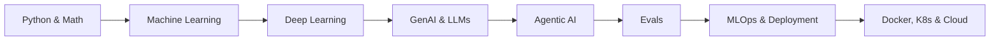

<div align="center">

# 🧠 AI/ML Handwritten Notes

**My personal handwritten notes on the full AI/ML journey: from Python and math to LLMs, Agentic AI, MLOps, and cloud.**


</div>

---

## 📖 About

A growing knowledge base for learning and exploring AI/ML technologies. Every note is handwritten while learning, then organized by topic so it's easy to revisit, revise, and build on.

The journey covers: **Python → Mathematics → Machine Learning → Deep Learning → GenAI → Agentic AI → PostgreSQL → Evals → LLMs → MLOps → Docker → Kubernetes → Model Deployment → Cloud Computing**

## 🗺️ Learning Roadmap



## 🧰 Topics Covered

| Area | What's Inside |
|------|---------------|
| 🐍 **Programming & Data** | Python, SQL, Pandas, NumPy, Data Preprocessing, Feature Engineering |
| 🤖 **Machine Learning** | Scikit-learn, ML Pipelines, Model Evaluation, Text Classification, TF-IDF |
| ✨ **Generative AI / LLMs** | LLM API Integration, Prompt Engineering, System Prompts, Conversation Memory, RAG, Semantic Search, AI App Deployment |
| 🕸️ **Agentic AI** | LangGraph, LangChain, Agentic Workflows, Multi-Agent Systems, Tool Calling, State Management |
| 🔎 **Vector DB & Embeddings** | ChromaDB, Hugging Face Embeddings, Vector Search |
| 🛠️ **Frameworks & Tools** | FastAPI, Streamlit, Streamlit Community Cloud, Git, GitHub, Matplotlib, Seaborn |
| 🔌 **Models & APIs** | Mistral AI, Google Gemini, Groq, Tavily Search API |
| 🚢 **DevOps & Databases** | Docker, Kubernetes, PostgreSQL, Model/LLM Evals |

## 📂 Repository Structure

```text
.
├── 01-python-and-data/
├── 02-machine-learning/
├── 03-deep-learning/
├── 04-genai-and-llms/
├── 05-agentic-ai/
├── 06-vector-db-and-embeddings/
├── 07-evals/
├── 08-mlops-docker-kubernetes/
├── 09-cloud-and-deployment/
└── README.md
```

> 📝 Adjust folder names to match your actual layout.

## 🚀 How to Use

1. **Clone the repo**
   ```bash
   git clone https://github.com/<your-username>/<your-repo>.git
   cd <your-repo>
   ```
2. **Browse by topic**: open any folder and follow the notes in order.
3. **Revise fast**: use the roadmap above to jump to the stage you need.

## 🎯 Who This Is For

- Learners following a structured path into AI/ML and GenAI
- Developers moving from classic ML into LLMs and agents
- Anyone who wants quick, visual, no-fluff revision notes

## 🔮 What's Next

- [ ] More Agentic AI patterns and multi-agent examples
- [ ] LLM evals deep-dive
- [ ] Kubernetes model-serving notes
- [ ] Cloud deployment walkthroughs

## 🤝 Contributing

Spotted a mistake or have a better explanation? Open an issue or submit a PR. Suggestions are always welcome.

## ⭐ Support

If these notes help you, give the repo a star and share it with someone on the same journey.

---

<div align="center">

Made with ☕ and a lot of handwriting.

</div>
