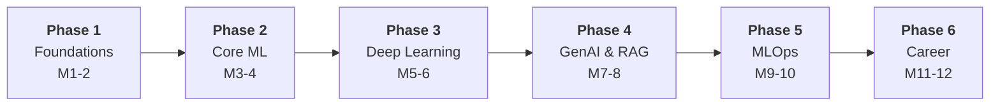

<div align="center">
  

  <h1>🧠 AI/ML Handwritten Notes</h1>
  <h3>A 12-month, chapter-wise journey from Python to production-grade AI</h3>
  
  <p>My personal handwritten notes covering <b>Python, Mathematics, Machine Learning, Deep Learning, GenAI, LLMs, RAG, Agentic AI, PostgreSQL, Evals, MLOps, Docker, Kubernetes, Model Deployment and Cloud</b>, organized phase by phase.</p>

  <p>
    
    
    
    
    
    
    
    
  </p>

  <p>
    
    
    
    
    
  </p>
</div>

<br/>

## 📑 Table of Contents

<div align="center">

| | |
|:---:|:---:|
| [📖 About the Journey](#-about-the-journey) | [🗺️ Roadmap at a Glance](#️-roadmap-at-a-glance) |
| [📚 Detailed Roadmap](#-detailed-roadmap-chapter-wise) | [🛠️ Projects You'll Build](#️-projects-youll-build) |
| [🚀 Beyond the Roadmap](#-beyond-the-roadmap) | [🧰 Tech Stack](#-tech-stack) |
| [📂 Repository Structure](#-repository-structure) | [🚀 How to Use](#-how-to-use-this-repo) |
| [🤝 Contributing](#-contributing) | [⭐ Support](#-support) |

</div>

<br/>

---

## 📖 About the Journey

This repository is my **growing knowledge base** for learning and exploring the depths of AI and Machine Learning. Every concept is first written by hand to cement understanding, then digitized and organized here for quick revision and future reference.

The notes follow a **12-month, six-phase, chapter-wise roadmap** (108 chapters in total). It starts with Python and math, moves through classical ML and deep learning, then into GenAI, LLMs, RAG, and agents, finishing with MLOps, deployment, and building a portfolio.

**What you'll find here:**
- ✍️ **Handwritten, concept-first notes** (one folder per chapter)
- 🧪 **Hands-on code** and mini-projects for every phase
- 🚀 **Production topics:** APIs, Docker, Kubernetes, CI/CD, monitoring, and cloud
- 🎯 **Career material:** portfolio building, README writing, Kaggle, and interview prep

> [!NOTE]
> **💡 Philosophy:** Build projects, understand concepts deeply, and stay consistent. **Consistency > Motivation.**

---

## 🗺️ Roadmap at a Glance



| Phase | Focus | Months | 🎯 You'll Be Able To |
|:-----:|-------|:------:|-------------------|
| **1** | **Foundations** | `1-2` | Code in Python, wrangle data with NumPy/Pandas, and understand the math behind ML. |
| **2** | **Core Machine Learning** | `3-4` | Train, evaluate, and tune classical ML models. |
| **3** | **Deep Learning & Advanced AI** | `5-6` | Build neural networks, CNNs, RNNs/LSTMs, and understand Transformers and BERT. |
| **4** | **GenAI, LLMs & RAG** | `7-8` | Build LLM apps with RAG, memory, tools, and evaluation. |
| **5** | **MLOps & Production** | `9-10` | Ship models as APIs, containerize, automate CI/CD, and monitor in the cloud. |
| **6** | **Portfolio & Career** | `11-12` | Present projects, compete, interview, and land AI/ML work. |

---

## 📚 Detailed Roadmap (Chapter-wise)

Each phase has exactly 18 chapters. Click on a phase to expand it.

<details open>
<summary>

**🟢 Phase 1: Foundations (Months 1-2)**
</summary>

**Goal:** A solid base in Python, data handling, math, and tooling.

| # | Chapter | # | Chapter |
|:---:|---|:---:|---|
| 1 | Introduction to Python | 10 | Pandas Advanced |
| 2 | Python Basics | 11 | Data Cleaning with Pandas |
| 3 | Data Structures in Python | 12 | Data Visualization with Matplotlib |
| 4 | Functions & Modules | 13 | Linear Algebra (Matrices, Vectors) |
| 5 | Object-Oriented Programming | 14 | Calculus (Basics) |
| 6 | File Handling | 15 | Probability |
| 7 | NumPy Basics | 16 | Statistics (Basics) |
| 8 | NumPy Advanced | 17 | Git & GitHub Basics |
| 9 | Pandas Basics | 18 | Jupyter Notebook |

**🛠️ Tools:** `Python` · `NumPy` · `Pandas` · `Matplotlib` · `Seaborn` · `SQL` · `Git` · `GitHub` · `Jupyter`

</details>

<details>
<summary>

**🔵 Phase 2: Core Machine Learning (Months 3-4)**
</summary>

**Goal:** Understand the classical algorithms and how to evaluate them properly.

| # | Chapter | # | Chapter |
|:---:|---|:---:|---|
| 1 | What is Machine Learning? | 10 | Dimensionality Reduction (PCA) |
| 2 | Types of Machine Learning | 11 | Model Evaluation Techniques |
| 3 | Linear Regression | 12 | Confusion Matrix |
| 4 | Logistic Regression | 13 | Precision, Recall & F1 Score |
| 5 | Decision Trees | 14 | Bias-Variance Trade-off |
| 6 | Support Vector Machines (SVM) | 15 | Cross Validation |
| 7 | Naive Bayes | 16 | Hyperparameter Tuning |
| 8 | K-Nearest Neighbors (KNN) | 17 | ML Project 1 |
| 9 | Clustering: K-Means | 18 | ML Project 2 |

**🛠️ Tools:** `Scikit-learn` · `ML Pipelines` · `Feature Engineering` · `Text Classification` · `TF-IDF`

</details>

<details>
<summary>

**🟣 Phase 3: Deep Learning & Advanced AI (Months 5-6)**
</summary>

**Goal:** Go from perceptrons to Transformers and build models in PyTorch.

| # | Chapter | # | Chapter |
|:---:|---|:---:|---|
| 1 | Introduction to Neural Networks | 10 | Recurrent Neural Networks (RNN) |
| 2 | Perceptron | 11 | LSTM Networks |
| 3 | Activation Functions | 12 | Introduction to Transformers |
| 4 | Feedforward Neural Networks | 13 | Natural Language Processing (NLP) |
| 5 | Backpropagation | 14 | BERT Basics |
| 6 | Gradient Descent | 15 | PyTorch Basics |
| 7 | Overfitting & Regularization | 16 | Building Deep Learning Models |
| 8 | Convolutional Neural Networks (CNN) | 17 | Deep Learning Project 1 |
| 9 | Computer Vision with CNN | 18 | Deep Learning Project 2 |

**🛠️ Tools:** `PyTorch` · `Hugging Face` · `CNNs` · `RNNs` · `LSTMs` · `Transformers` · `BERT`

</details>

<details>
<summary>

**🟠 Phase 4: GenAI, LLMs & RAG (Months 7-8)**
</summary>

**Goal:** Build real LLM applications with retrieval, memory, tools, and evaluation.

| # | Chapter | # | Chapter |
|:---:|---|:---:|---|
| 1 | Introduction to Generative AI | 10 | Vector Databases (FAISS / Chroma) |
| 2 | Large Language Models (LLMs) | 11 | Building RAG Applications |
| 3 | Prompt Engineering Basics | 12 | Memory in AI Applications |
| 4 | Advanced Prompt Engineering | 13 | Agents & Tools |
| 5 | OpenAI API | 14 | Function Calling |
| 6 | Anthropic API (Claude) | 15 | Evaluating LLM Applications |
| 7 | Google Gemini API | 16 | LLM Project 1 |
| 8 | LangChain Basics | 17 | LLM Project 2 |
| 9 | Retrieval-Augmented Generation (RAG) | 18 | RAG Project (End to End) |

**🛠️ Tools:** `LangChain` · `ChromaDB` · `FAISS` · `OpenAI` · `Claude` · `Gemini` · `Embeddings` · `Semantic Search`

</details>

<details>
<summary>

**🔴 Phase 5: MLOps & Production (Months 9-10)**
</summary>

**Goal:** Take models from notebooks to monitored, deployed services.

| # | Chapter | # | Chapter |
|:---:|---|:---:|---|
| 1 | What is MLOps? | 10 | MLflow Basics |
| 2 | Model Deployment Overview | 11 | Experiment Tracking |
| 3 | FastAPI Basics | 12 | Model Registry |
| 4 | Flask Basics | 13 | Model Monitoring |
| 5 | Building API for ML Models | 14 | Data Drift & Concept Drift |
| 6 | Docker Basics | 15 | Cloud Platforms Overview (AWS/GCP/Azure) |
| 7 | Dockerizing ML Applications | 16 | Deploying on Cloud |
| 8 | Introduction to Kubernetes | 17 | MLOps Project 1 |
| 9 | CI/CD for ML (GitHub Actions) | 18 | MLOps Project 2 |

**🛠️ Tools:** `FastAPI` · `Flask` · `Docker` · `Kubernetes` · `MLflow` · `GitHub Actions` · `AWS / GCP / Azure`

</details>

<details>
<summary>

**🟡 Phase 6: Portfolio & Career (Months 11-12)**
</summary>

**Goal:** Turn everything learned into a portfolio and a career plan.

| # | Chapter | # | Chapter |
|:---:|---|:---:|---|
| 1 | End-to-End Project Planning | 10 | Mock Interviews: ML |
| 2 | Building Real-World Projects | 11 | Explaining ML Projects |
| 3 | Data Storytelling | 12 | Communication Skills |
| 4 | GitHub Portfolio Setup | 13 | Freelancing with AI/ML |
| 5 | Writing README.md | 14 | Open Source Contributions |
| 6 | Kaggle Basics | 15 | Personal Branding (LinkedIn) |
| 7 | Participating in Competitions | 16 | Career Roadmap Beyond 12 Months |
| 8 | Resume for AI/ML Roles | 17 | Final Capstone Project |
| 9 | System Design for ML Applications | 18 | Project Deployment & Hosting |

**🛠️ Tools:** `GitHub` · `Kaggle` · `LinkedIn` · `Streamlit Community Cloud`

</details>

---

## 🛠️ Projects You'll Build

| Phase | 🏆 Project | 📚 What It Covers |
|:-----:|:-----------|:------------------|
| **2** | **ML Project 1 & 2** | End-to-end classical ML: preprocessing, training, evaluation, tuning. |
| **3** | **Deep Learning Project 1 & 2** | Neural networks in PyTorch, including CNN-based vision and sequence models. |
| **4** | **LLM Project 1 & 2** | LLM apps with prompting, memory, and tool use. |
| **4** | **RAG Project (End to End)** | Document ingestion, embeddings, vector search, and a chat interface. |
| **5** | **MLOps Project 1 & 2** | Model API, Docker, CI/CD, experiment tracking, and cloud deployment. |
| **6** | **Final Capstone Project** | A production-style, deployed, portfolio-ready application. |

---

## 🚀 Beyond the Roadmap

Extra topics I'm also covering in these notes alongside the core phases:

| Topic | What's Inside |
|:------|:--------------|
| 🕸️ **Agentic AI** | LangGraph, Agentic Workflows, Multi-Agent Systems, Tool Calling, State Management |
| 🗄️ **Databases** | PostgreSQL, SQL for data work |
| ✅ **Evals** | Model and LLM evaluation, benchmarking, test datasets |
| 🔎 **Embeddings & Vector Search** | Hugging Face Embeddings, ChromaDB, Semantic Search |
| 🔌 **Model APIs** | Mistral AI, Google Gemini, Groq, Tavily Search API |
| 🖥️ **App Building** | Streamlit, Streamlit Community Cloud, AI App Deployment |

---

## 🧰 Tech Stack

| Category | Technologies |
|:---------|:-------------|
| **💻 Programming & Data** | Python, SQL, Pandas, NumPy, Data Preprocessing, Feature Engineering |
| **📈 Machine Learning** | Scikit-learn, ML Pipelines, Model Evaluation, Text Classification, TF-IDF |
| **✨ Generative AI / LLMs** | LLM API Integration, Prompt Engineering, System Prompts, Conversation Memory, RAG, Semantic Search |
| **🤖 Agentic AI** | LangGraph, LangChain, Agentic Workflows, Multi-Agent Systems, Tool Calling, State Management |
| **🗄️ Vector DB & Embeddings** | ChromaDB, Hugging Face Embeddings, Vector Search |
| **🛠️ Frameworks & Tools** | FastAPI, Streamlit, Streamlit Community Cloud, Git, GitHub, Matplotlib, Seaborn |
| **☁️ Models & APIs** | Mistral AI, Google Gemini, Groq, Tavily Search API |
| **🚀 DevOps & Databases** | Docker, Kubernetes, PostgreSQL, Model/LLM Evals |

---

## 📂 Repository Structure

```text
.
├── 📁 phase-1-foundations/
│   ├── 01-introduction-to-python/
│   ├── 02-python-basics/
│   ├── ...
│   └── 18-jupyter-notebook/
├── 📁 phase-2-core-ml/
├── 📁 phase-3-deep-learning/
├── 📁 phase-4-genai-llms-rag/
├── 📁 phase-5-mlops-production/
├── 📁 phase-6-portfolio-career/
├── 📁 projects/
│   ├── ml/
│   ├── deep-learning/
│   ├── llm-rag/
│   ├── mlops/
│   └── capstone/
└── 📄 README.md
```

> [!IMPORTANT]
> Each chapter folder holds the handwritten note (scanned image or PDF) and any code used for that chapter. Adjust folder names to match your actual layout.

---

## 🚀 How to Use This Repo

1. **Clone the repository**
```bash
   git clone https://github.com/<your-username>/<your-repo>.git
   cd <your-repo>
```
2. **Pick your phase.** Follow the phases in order, or jump to the one you need.
3. **Read, then build.** Go through each chapter's notes, then do the chapter code or project.
4. **Revise fast.** Use the chapter tables as a checklist and revisit weak areas.

> [!TIP]
> **Suggested weekly rhythm:** Learn concepts early in the week, code mid-week, build or revise at the weekend.

---

## 🤝 Contributing

Found a mistake, or have a clearer explanation? Open an issue or submit a pull request. Suggestions and corrections are always welcome!

## 🙏 Credits

- **Roadmap:** *AI/ML Roadmap, Chapter-wise, 12 Months* by **Aniket Sharma**.
- **Notes, code, and projects:** Written and maintained by me while learning.

---

<div align="center">

### ⭐ Support

If these notes help you, give the repo a star and share it with someone on the same journey!

<br/>

> [!NOTE]
> **🎯 Pro Tip:** Focus on building projects and understanding concepts deeply. <br/>
> **Consistency > Motivation. Keep coding!** ☕✨

</div> 
