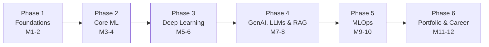

<div align="center">

# 🧠 AI/ML Handwritten Notes

**My personal handwritten notes on the full AI/ML journey: from Python and math to LLMs, Agentic AI, MLOps, and cloud.**


</div>

---

## 📖 About

A growing knowledge base for learning and exploring AI/ML technologies. Every note is handwritten while learning, then organized by topic so it's easy to revisit, revise, and build on.

The journey covers: **Python → Mathematics → Machine Learning → Deep Learning → GenAI → Agentic AI → PostgreSQL → Evals → LLMs → MLOps → Docker → Kubernetes → Model Deployment → Cloud Computing**

## 🗺️ 12-Month Roadmap: Chapter-wise

> Roadmap by **Aniket Sharma**. Six phases, 18 chapters each. Expand a phase to see its chapters.



<details>
<summary><b>🟢 Phase 1: Foundations (Months 1-2)</b></summary>

| # | Chapter | # | Chapter |
|---|---------|---|---------|
| 1 | Introduction to Python | 10 | Pandas Advanced |
| 2 | Python Basics | 11 | Data Cleaning with Pandas |
| 3 | Data Structures in Python | 12 | Data Visualization with Matplotlib |
| 4 | Functions & Modules | 13 | Linear Algebra (Matrices, Vectors) |
| 5 | Object-Oriented Programming | 14 | Calculus (Basics) |
| 6 | File Handling | 15 | Probability |
| 7 | NumPy Basics | 16 | Statistics (Basics) |
| 8 | NumPy Advanced | 17 | Git & GitHub Basics |
| 9 | Pandas Basics | 18 | Jupyter Notebook |

</details>

<details>
<summary><b>🔵 Phase 2: Core Machine Learning (Months 3-4)</b></summary>

| # | Chapter | # | Chapter |
|---|---------|---|---------|
| 1 | What is Machine Learning? | 10 | Dimensionality Reduction (PCA) |
| 2 | Types of Machine Learning | 11 | Model Evaluation Techniques |
| 3 | Linear Regression | 12 | Confusion Matrix |
| 4 | Logistic Regression | 13 | Precision, Recall & F1 Score |
| 5 | Decision Trees | 14 | Bias-Variance Trade-off |
| 6 | Support Vector Machines (SVM) | 15 | Cross Validation |
| 7 | Naive Bayes | 16 | Hyperparameter Tuning |
| 8 | K-Nearest Neighbors (KNN) | 17 | ML Project 1 |
| 9 | Clustering: K-Means | 18 | ML Project 2 |

</details>

<details>
<summary><b>🟣 Phase 3: Deep Learning & Advanced AI (Months 5-6)</b></summary>

| # | Chapter | # | Chapter |
|---|---------|---|---------|
| 1 | Introduction to Neural Networks | 10 | Recurrent Neural Networks (RNN) |
| 2 | Perceptron | 11 | LSTM Networks |
| 3 | Activation Functions | 12 | Introduction to Transformers |
| 4 | Feedforward Neural Networks | 13 | Natural Language Processing (NLP) |
| 5 | Backpropagation | 14 | BERT Basics |
| 6 | Gradient Descent | 15 | PyTorch Basics |
| 7 | Overfitting & Regularization | 16 | Building Deep Learning Models |
| 8 | Convolutional Neural Networks (CNN) | 17 | Deep Learning Project 1 |
| 9 | Computer Vision with CNN | 18 | Deep Learning Project 2 |

</details>

<details>
<summary><b>🟠 Phase 4: GenAI, LLMs & RAG (Months 7-8)</b></summary>

| # | Chapter | # | Chapter |
|---|---------|---|---------|
| 1 | Introduction to Generative AI | 10 | Vector Databases (FAISS / Chroma) |
| 2 | Large Language Models (LLMs) | 11 | Building RAG Applications |
| 3 | Prompt Engineering Basics | 12 | Memory in AI Applications |
| 4 | Advanced Prompt Engineering | 13 | Agents & Tools |
| 5 | OpenAI API | 14 | Function Calling |
| 6 | Anthropic API (Claude) | 15 | Evaluating LLM Applications |
| 7 | Google Gemini API | 16 | LLM Project 1 |
| 8 | LangChain Basics | 17 | LLM Project 2 |
| 9 | Retrieval-Augmented Generation (RAG) | 18 | RAG Project (End to End) |

</details>

<details>
<summary><b>🔴 Phase 5: MLOps & Production (Months 9-10)</b></summary>

| # | Chapter | # | Chapter |
|---|---------|---|---------|
| 1 | What is MLOps? | 10 | MLflow Basics |
| 2 | Model Deployment Overview | 11 | Experiment Tracking |
| 3 | FastAPI Basics | 12 | Model Registry |
| 4 | Flask Basics | 13 | Model Monitoring |
| 5 | Building API for ML Models | 14 | Data Drift & Concept Drift |
| 6 | Docker Basics | 15 | Cloud Platforms Overview (AWS/GCP/Azure) |
| 7 | Dockerizing ML Applications | 16 | Deploying on Cloud |
| 8 | Introduction to Kubernetes | 17 | MLOps Project 1 |
| 9 | CI/CD for ML (GitHub Actions) | 18 | MLOps Project 2 |

</details>

<details>
<summary><b>🟡 Phase 6: Portfolio & Career (Months 11-12)</b></summary>

| # | Chapter | # | Chapter |
|---|---------|---|---------|
| 1 | End-to-End Project Planning | 10 | Mock Interviews: ML |
| 2 | Building Real-World Projects | 11 | Explaining ML Projects |
| 3 | Data Storytelling | 12 | Communication Skills |
| 4 | GitHub Portfolio Setup | 13 | Freelancing with AI/ML |
| 5 | Writing README.md | 14 | Open Source Contributions |
| 6 | Kaggle Basics | 15 | Personal Branding (LinkedIn) |
| 7 | Participating in Competitions | 16 | Career Roadmap Beyond 12 Months |
| 8 | Resume for AI/ML Roles | 17 | Final Capstone Project |
| 9 | System Design for ML Applications | 18 | Project Deployment & Hosting |

</details>

> 💡 **Pro tip:** Focus on building projects and understanding concepts deeply. **Consistency > Motivation.** Keep coding!

## 🧰 Topics Covered

| Area | What's Inside |
|------|---------------|
| 🐍 **Programming & Data** | Python, SQL, Pandas, NumPy, Data Preprocessing, Feature Engineering |
| 🤖 **Machine Learning** | Scikit-learn, ML Pipelines, Model Evaluation, Text Classification, TF-IDF |
| ✨ **Generative AI / LLMs** | LLM API Integration, Prompt Engineering, System Prompts, Conversation Memory, RAG, Semantic Search, AI App Deployment |
| 🕸️ **Agentic AI** | LangGraph, LangChain, Agentic Workflows, Multi-Agent Systems, Tool Calling, State Management |
| 🔎 **Vector DB & Embeddings** | ChromaDB, Hugging Face Embeddings, Vector Search |
| 🛠️ **Frameworks & Tools** | FastAPI, Streamlit, Streamlit Community Cloud, Git, GitHub, Matplotlib, Seaborn |
| 🔌 **Models & APIs** | Mistral AI, Google Gemini, Groq, Tavily Search API |
| 🚢 **DevOps & Databases** | Docker, Kubernetes, PostgreSQL, Model/LLM Evals |

## 📂 Repository Structure

```text
.
├── phase-1-foundations/
├── phase-2-core-ml/
├── phase-3-deep-learning/
├── phase-4-genai-llms-rag/
├── phase-5-mlops-production/
├── phase-6-portfolio-career/
└── README.md
```

> 📝 Adjust folder names to match your actual layout.

## 🚀 How to Use

1. **Clone the repo**
   ```bash
   git clone https://github.com/<your-username>/<your-repo>.git
   cd <your-repo>
   ```
2. **Browse by topic**: open any folder and follow the notes in order.
3. **Revise fast**: use the roadmap above to jump to the stage you need.

## 🎯 Who This Is For

- Learners following a structured path into AI/ML and GenAI
- Developers moving from classic ML into LLMs and agents
- Anyone who wants quick, visual, no-fluff revision notes

## 🔮 What's Next

- [ ] More Agentic AI patterns and multi-agent examples
- [ ] LLM evals deep-dive
- [ ] Kubernetes model-serving notes
- [ ] Cloud deployment walkthroughs

## 🤝 Contributing

Spotted a mistake or have a better explanation? Open an issue or submit a PR. Suggestions are always welcome.

## ⭐ Support

If these notes help you, give the repo a star and share it with someone on the same journey.

---

<div align="center">

Made with ☕ and a lot of handwriting.

</div>
